<p align="center">
  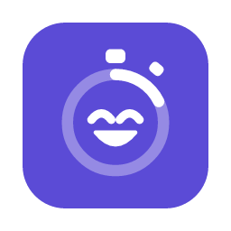
</p>

<h1 align="center">Headstart</h1>

<p align="center">
  A study companion that helps you <b>get started</b>, <b>stay focused</b> and <b>keep going</b>,<br>
  with a study buddy who cheers you on and dresses up in what you earn by studying.
</p>

<p align="center">
  <a href="https://github.com/ChonkieMonkie/headstart/releases/latest"><b>Download the latest release</b></a>
  · Windows · macOS · Linux · free and open source
</p>

<p align="center">
  <a href="https://github.com/ChonkieMonkie/headstart/releases/latest"></a>
  <a href="https://github.com/ChonkieMonkie/headstart/actions/workflows/ci.yml"></a>
  <a href="LICENSE"></a>
</p>

<p align="center">
  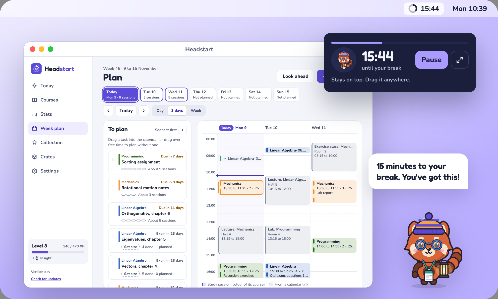
</p>

## Why Headstart

The hardest part of studying is starting. A blank afternoon and a vague "I should read chapter 5" make it easy to put off, and a long session with no breaks makes it hard to keep going.

Headstart turns studying into small, concrete sessions:

- **Starting takes one click.** Every task has a first to-do, such as "Redo problem 5.7 d", so you never sit down wondering where to begin.
- **Sessions are short and calm.** A 25-minute countdown (or 50, or just 5 to get going), then a break that starts once you have written down what you remember, so writing never eats into it.
- **You remember more.** After each session you write down what you recall without looking. Retrieving what you learned is one of the best-tested ways to make it stick.
- **Showing up is what counts.** Starting on time, staying focused and writing your recall earn XP and Study Crates. Crates hold items for your study buddy, and they are only ever earned by studying, never sold.
- **Planning fits your week.** Plan the next few days around your lectures, drag tasks into free time, and see every session in your own calendar.
- **It is yours.** Everything is stored on your computer. No account, no ads, no tracking.

## How a session works

<p align="center">
  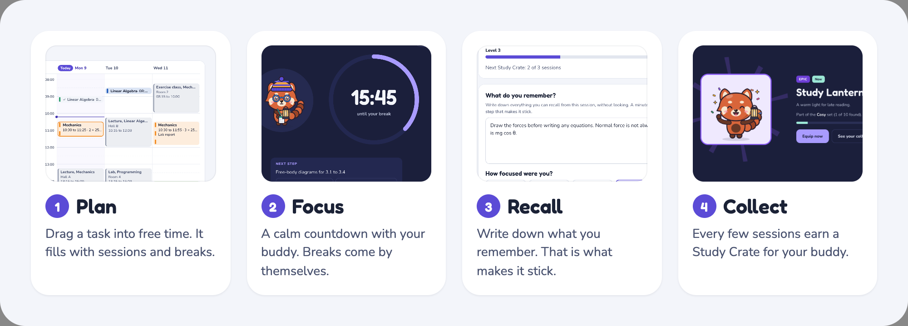
</p>

1. **Plan.** Add your courses, their tasks and to-dos. Drag a task into the week plan, or drag over free time, and it fills with sessions and breaks.
2. **Focus.** Start in one click from the app, the menu bar or a keyboard shortcut. Study in the window, in full screen or with a small timer that floats above everything else.
3. **Recall.** When the timer ends, write down what you remember, rate your focus and tick off what you got done. The rest goes back on the list.
4. **Collect.** Every three sessions earn a Study Crate. Open it for an item, put it on your buddy, and work towards complete sets.

## Plan your week

<p align="center">
  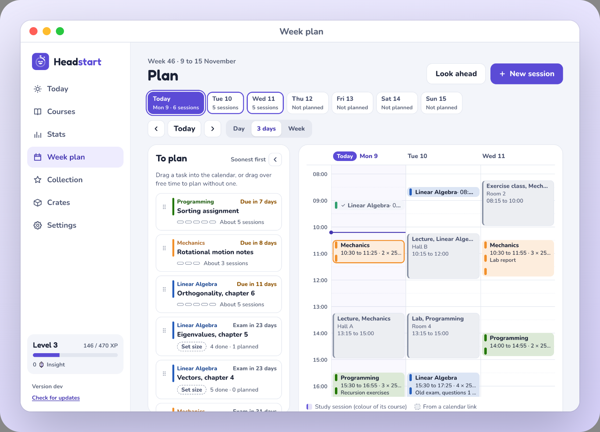
</p>
<p align="center"><b>Week plan.</b> The next few days, one day or the whole week, with your lectures as busy time and the tasks that still need sessions beside it.</p>

- **Drag to plan.** Drag over free time, or drag a task from To plan into the calendar. Two hours become 4 × 25 minutes with breaks, kept together as one block that you move and change in one go.
- **Tasks know what is left.** Give a task a rough size or your own number of sessions and a date. To plan shows what is done, planned and still to plan, soonest first.
- **Your schedule comes along.** Add a TimeEdit, Canvas or other calendar link, or import an `.ics` file, and plan around your lectures. On macOS, every session can also show up in Apple Calendar, on your phone too.
- **Moves like a calendar.** Swipe with two fingers to go back and forth, and fold To plan away when you only want the calendar.

<p align="center">
  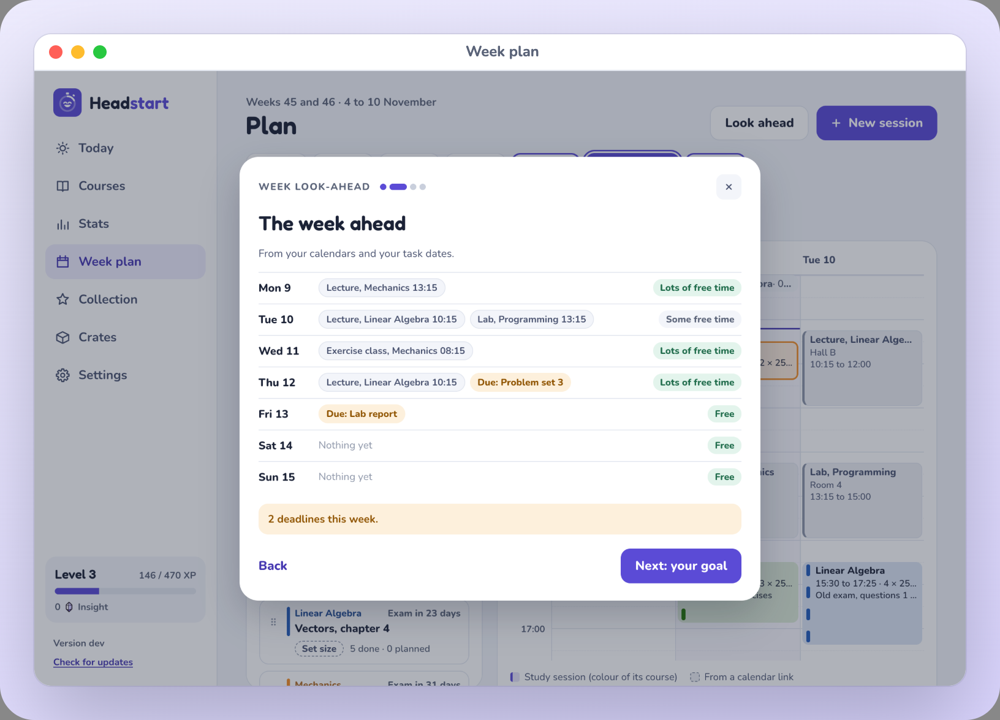
</p>
<p align="center"><b>Weekly look-ahead.</b> Optional, two minutes on a day you choose: last week in numbers, the week ahead, a goal and planning the next two days.</p>

## Meet your study buddy

<p align="center">
  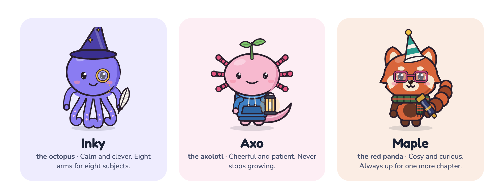
</p>

Pick **Inky**, **Axo** or **Maple** when you first open the app. Your buddy shows up on the Today screen, in the focus view, the compact timer and the tray panel, and its mood follows your day: focused with you, relaxing on a break, celebrating a finished session, nudging you when a planned session is due and sleepy late at night.

<p align="center">
  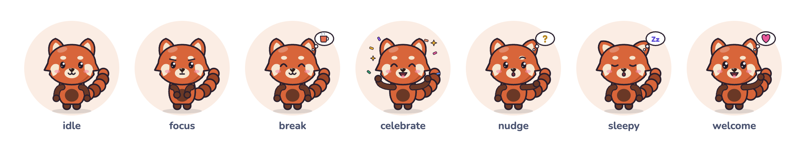
</p>

There are **154 items** to find in five themed sets, from simple commons to animated legendary skins. Duplicates turn into **Insight**, which crafts the exact item you are missing. Bad luck has a ceiling: an Epic is guaranteed within 15 crates and a Legendary within 60, and every drop chance is shown before you open a crate.

## A look inside

<p align="center">
  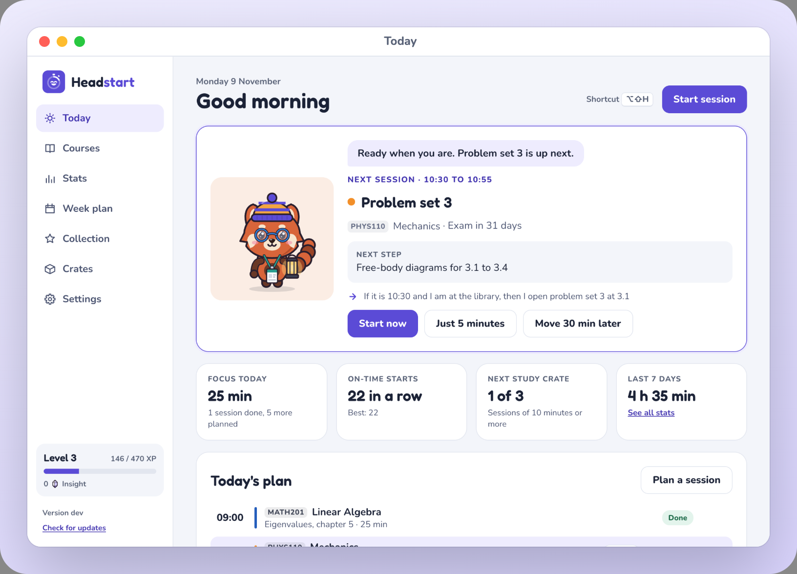
</p>
<p align="center"><b>Today.</b> The next session with its first step and if-then plan, one click from starting, and the rest of today's plan below.</p>

<p align="center">
  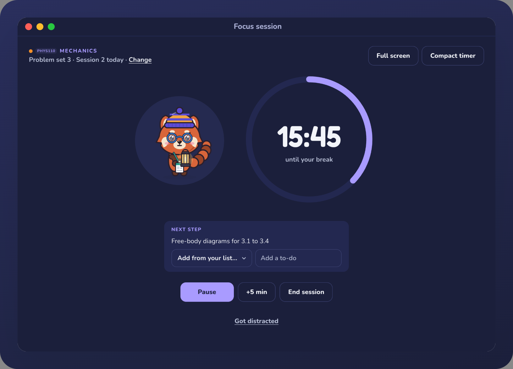
</p>
<p align="center"><b>Focus.</b> A big, calm countdown and the to-dos this session is for. Space pauses, +5 min extends, and you can switch course mid-session.</p>

<p align="center">
  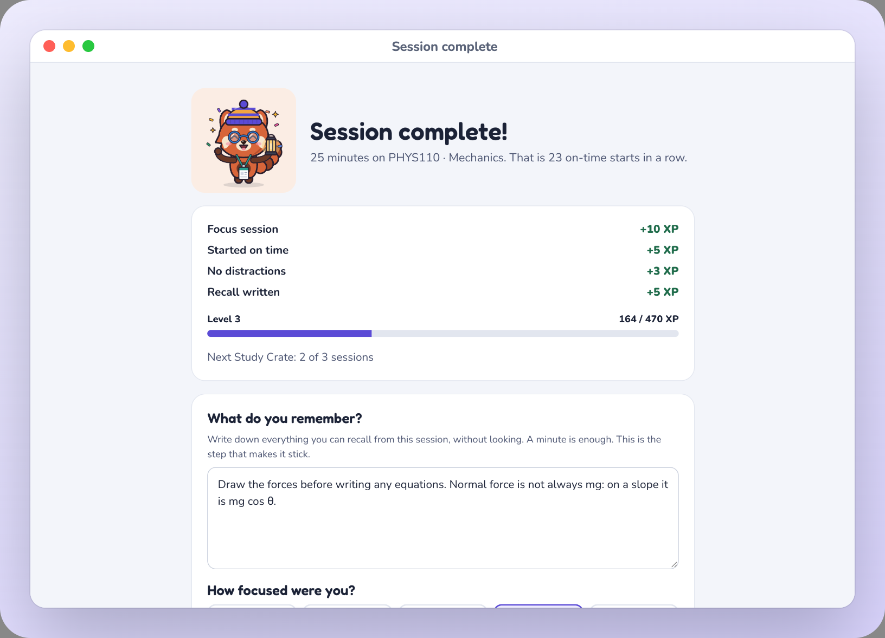
</p>
<p align="center"><b>Session complete.</b> What you earned, then a minute to write down what you remember.</p>

<p align="center">
  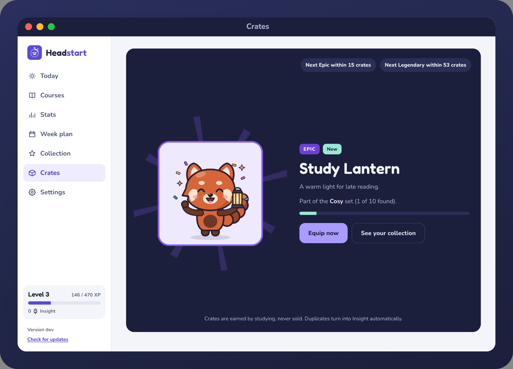
</p>
<p align="center"><b>Study Crates.</b> Each item is revealed on your own buddy and can be put on right away.</p>

<p align="center">
  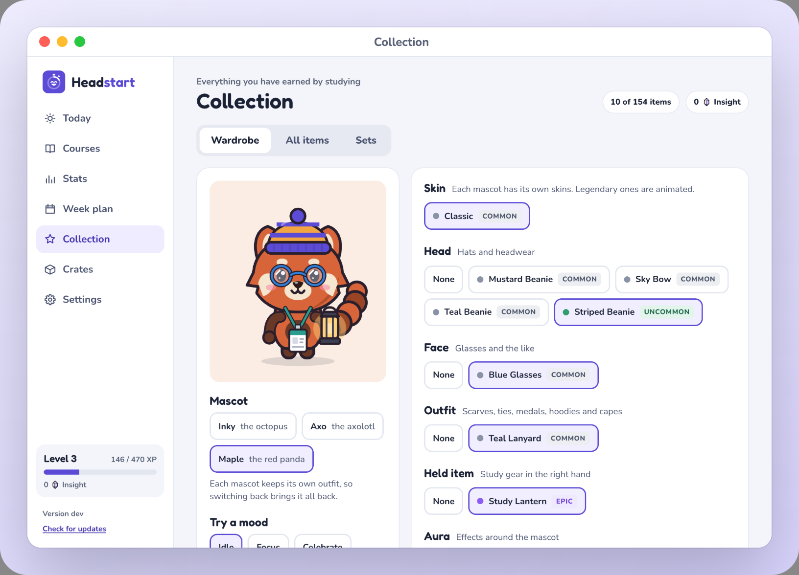
</p>
<p align="center"><b>Collection.</b> A wardrobe for each buddy, every item in the catalogue and your progress on each set.</p>

<p align="center">
  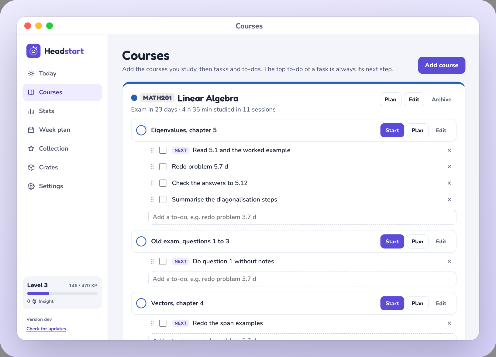
</p>
<p align="center"><b>Courses.</b> Course codes, tasks and to-dos you drag into the order you want. The top one is always the next step.</p>

<p align="center">
  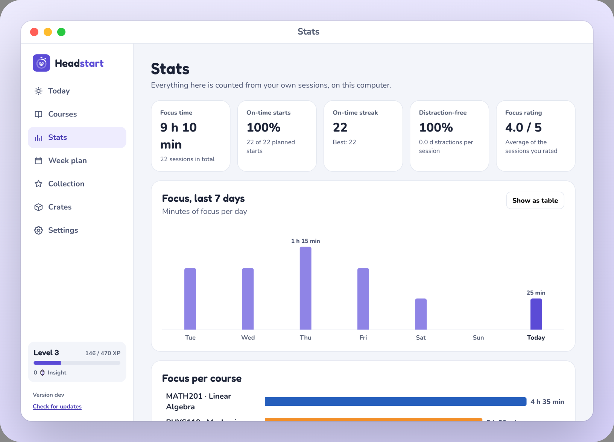
</p>
<p align="center"><b>Stats.</b> Focus time per day and per course, on-time starts, streaks and how focused your sessions felt.</p>

## What it does today

- **Today:** the next planned session with its to-dos and if-then plan, today's plan (sessions planned together show as one block), focus time, your on-time streak and crate progress.
- **Week plan:** the next few days or the whole week as a calendar, with your tasks beside it. Drag over free time or drag a task in: two hours become 4 × 25 minutes with breaks, kept together as one block you move and change in one go. Swipe with two fingers to go back and forth, and fold the task list away when you only want the calendar.
- **Tasks that know what is left:** give a task a rough size (Small, Medium, Large) or your own number of sessions and a date, and the planner shows what is done, planned and still to plan, soonest first.
- **Your schedule as busy time:** add a calendar link (TimeEdit, Canvas or any other `.ics` link, refreshed every hour) or import an `.ics` file. Lectures show in the week plan, so sessions fit around them.
- **Apple Calendar sync (macOS):** sessions you plan appear in a Headstart calendar in iCloud, on your phone too, and moving or deleting one in Calendar changes it in Headstart. Your other calendars can show as busy time.
- **Weekly look-ahead (optional):** two minutes on a day of your choice: last week in numbers, what is coming up, a goal for the week and planning the next two days.
- **Courses, tasks and to-dos:** course codes, exam dates with a countdown, and to-dos you can drag into order.
- **Planned sessions and reminders:** a notification before a session starts and one gentle nudge if it has not, at most a few a day. Starting on time earns a bonus.
- **Focus sessions** of 25 or 50 minutes or just 5, with breaks that follow the length and start once your notes are done, a long break after every fourth session in a row, and an optional automatic start of the next one.
- **Three ways to focus:** the normal window, full screen that stays on top, or a compact timer you can drag anywhere.
- **Menu bar and tray:** a progress ring with the countdown beside it on macOS, a panel to run a whole session without opening the app, and a global shortcut (<kbd>Alt</kbd>+<kbd>Shift</kbd>+<kbd>H</kbd>, <kbd>⌥⇧H</kbd> on a Mac).
- **Rewards:** XP and levels, Study Crates, Insight, crafting and a pity timer.
- **Light and dark:** a calm dark theme, a light one, or follow your computer. Picked during setup and changeable any time.
- **Settings:** theme, session length, breaks, reminders, nudges, sound, calendars, the weekly look-ahead, reduced motion and a test notification.
- **Updates** install from inside the app.

## Roadmap

<p align="center">
  <picture>
    <source media="(prefers-color-scheme: dark)" srcset="docs/readme/roadmap-dark.png">
    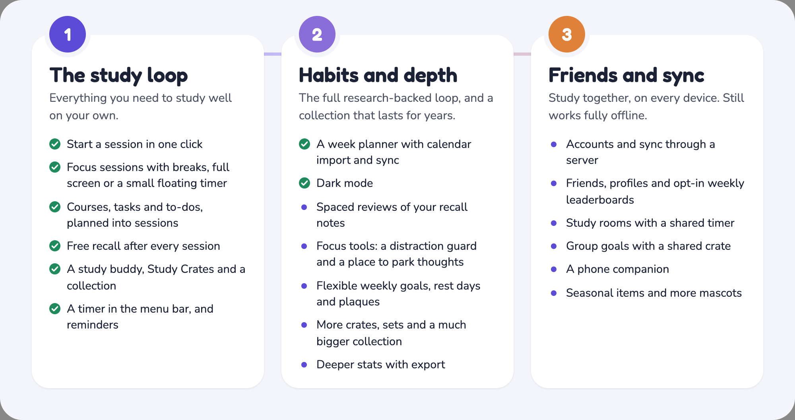
  </picture>
</p>

Headstart grows in three stages. **Stage 1 is out** ([v0.2.0](https://github.com/ChonkieMonkie/headstart/releases/tag/v0.2.0)), and **stage 2** is under way: the week planner and dark mode came in [v0.3.0](https://github.com/ChonkieMonkie/headstart/releases/tag/v0.3.0). Each stage ships in small releases, and installed apps update themselves. Stages 1 and 2 never need a server; stage 3 adds an optional one for sync and friends, and the app keeps working fully offline.

## Built to run all day

Headstart sits in your menu bar or tray from morning to night, so it is built to stay out of the way:

- **Small:** a 3 to 5 MB installer (the Linux AppImage bundles its own libraries), using the system's own web view instead of a bundled browser.
- **Quiet:** the timer runs natively and the tray only redraws when the ring moves a visible step. A hidden window updates every 15 seconds instead of every second, and the tray panel is only created the first time you open it.
- **Still when unseen:** every animation pauses while the window is hidden or has been in the background for a minute, and reduced motion turns them off.
- **Private:** everything is stored locally in an append-only event log (SQLite). Nothing leaves your computer, unless you turn on Apple Calendar sync, which puts your sessions in your own calendar. Calendar links are only read, and what they hold stays on your computer.

## Install

Download the installer for your system from the latest [release](https://github.com/ChonkieMonkie/headstart/releases).

The builds are not code signed yet, so the operating system warns the first time:

- **Windows:** SmartScreen says "Windows protected your PC". Click **More info → Run anyway**.
- **macOS:** right-click (or Control-click) **Headstart** in Applications and choose **Open**, then **Open** again. If macOS says the app is damaged, run `xattr -cr /Applications/Headstart.app` in Terminal once. If you turn on Apple Calendar sync, macOS asks once whether Headstart may use your calendars.
- **Linux:** use the `.deb` (Debian, Ubuntu), the `.rpm` (Fedora) or the `.AppImage` (any distro: `chmod +x` it first). On GNOME, the tray icon needs the *AppIndicator and KStatusNotifierItem Support* extension.

After that, updates install from inside the app.

## Developing

Requirements: [Node.js 24](https://nodejs.org) · [pnpm](https://pnpm.io) · [Rust](https://rustup.rs) · the [Tauri system dependencies](https://tauri.app/start/prerequisites/) for your OS.

```bash
pnpm install          # install everything
pnpm dev              # run the desktop app with hot reload
pnpm test             # unit tests
pnpm typecheck        # TypeScript and Svelte checks
pnpm lint             # Biome lint and format check (pnpm format fixes)
pnpm check:licenses   # make sure every dependency is GPL-compatible
pnpm build            # build installers for the current OS
pnpm --filter @headstart/core simulate   # simulate a semester: XP, levels and crate odds
pnpm --filter @headstart/ui preview:catalog catalog.html   # draw every item on every mascot it fits
cargo test --manifest-path apps/desktop/src-tauri/Cargo.toml   # Rust shell tests
```

`pnpm --filter @headstart/desktop dev` serves only the UI on <http://localhost:1420>. In a plain browser it keeps progress in memory and skips the tray, notifications and window layouts, which is handy for working on screens.

### Repository layout

```
apps/desktop/         Tauri 2 app: SvelteKit UI in src/, Rust shell in src-tauri/
                      (tray, focus layouts, notifications, global shortcut,
                      calendar links and Apple Calendar through EventKit)
packages/core/        domain logic in pure TypeScript: event log, timer, XP, crates, pity,
                      the week planner and a small .ics reader
packages/content/     items (with how each is drawn), sets, crate odds and reward rules as JSON,
                      validated at startup
packages/ui/          design tokens, fonts, the mascot renderer and shared Svelte components
scripts/              repository tooling, such as the licence check
.github/workflows/    CI and release builds for all three operating systems
```

### Releasing

1. Bump `version` in `apps/desktop/package.json` (the app reads it from there) and in `apps/desktop/src-tauri/Cargo.toml`.
2. Commit, then tag and push: `git tag v0.2.0 && git push --tags`.
3. The Release workflow builds every installer and creates a **draft** release.
4. Test the draft, then publish it. Installed apps pick up the update on their next start.

Update files are signed with the key in the `TAURI_SIGNING_PRIVATE_KEY` repository secret. The matching public key is in `apps/desktop/src-tauri/tauri.conf.json`. Never commit the private key.

## License

```
Headstart, a study companion that helps you get started, stay focused and keep going.
Copyright (C) 2026  ChonkieMonkie

This program is free software: you can redistribute it and/or modify
it under the terms of the GNU General Public License as published by
the Free Software Foundation, either version 3 of the License, or
(at your option) any later version.

This program is distributed in the hope that it will be useful,
but WITHOUT ANY WARRANTY; without even the implied warranty of
MERCHANTABILITY or FITNESS FOR A PARTICULAR PURPOSE.  See the
GNU General Public License for more details.

You should have received a copy of the GNU General Public License
along with this program.  If not, see <https://www.gnu.org/licenses/>.
```

The full license is in [LICENSE](LICENSE). The bundled Fredoka and Nunito fonts are licensed under the SIL Open Font License 1.1. Questions, bugs or ideas: open an
[issue on GitHub](https://github.com/ChonkieMonkie/headstart/issues).
